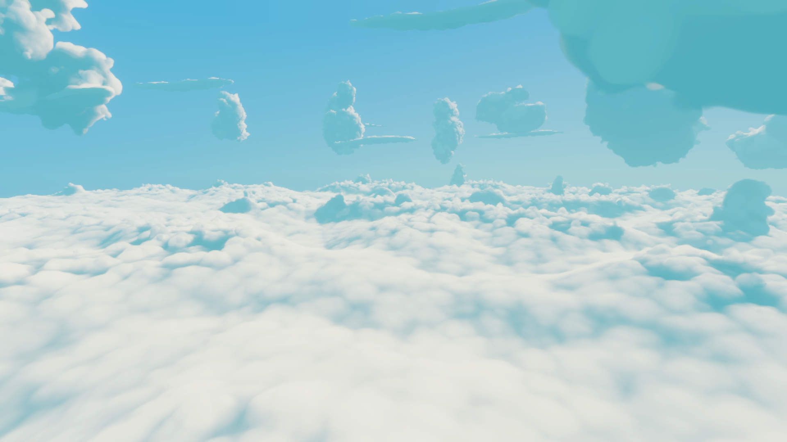
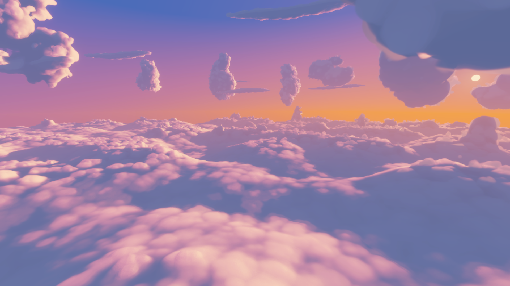
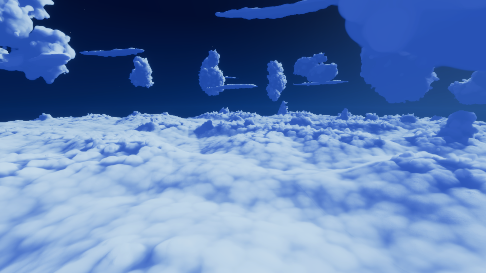

# 구름 최적화 재설계와 Player 실측 결과

작성일: 2026-10-05. 핵심 구현·검증은 10월 3일, 두 추가 기술과 배포 재확인은 10월 5일에 진행했다. 기준 프로젝트 GPU 소스는 `05cf3ff`이며, 현재 작업 트리의 변경은 아직 커밋하지 않았다.

**최종 보고서:** 제안된 핵심 기술과 조건부 법선·표면 확장을 비교 가능한 옵션으로 구현하고, GPU 품질 검사·Player 실측·최신 화면 검증을 마쳤다. 기본 채택 여부와 미달 항목을 아래에 구분했다.

## 결과와 채택 설정

첨부 논의의 우선 구현 항목인 **상층·운해 형태 필드, 법선 입력 공유, 차폐 범위 확대, 형상/조명 이력 분리, 바람 대응, 깊이 분산, 갱신 타일 압축, 보수적 빈 공간 탐색, 원경 내부 적분 조절**을 비교 가능한 옵션으로 구현했다. Player 측정과 GPU 출력 검사를 수행했다. 모든 옵션이 품질과 성능의 채택 조건을 통과한 것은 아니다.

현재 장면의 기본값은 **해상도 50% + 깊이 기반 업샘플링 + 거리별 밀도·조명 1.5배**다. 기존 셀 캐시·지원 범위 검사·압축 타깃은 유지한다. 새 실험 옵션은 기본 OFF다. 필드/차폐 캐시는 국소 가림·명암 오차가 크고, 시간 재사용/내부 적분은 평균 오차가 작아도 최악 픽셀과 반복 성능에서 채택 근거가 부족했다.

최신 Release 고정 경로에서 전체 프레임은 **28.776 → 14.916ms, 48.17% 감소**했고 평균 처리율은 **34.75 → 67.04FPS**였다. 실제 시간 비행은 **23.08 → 39.87FPS**였지만 반복 편차가 있어 이 개선율을 일반화하지 않는다. **구름 2ms와 전체 240FPS 목표는 달성하지 못했다.** 이 결과에는 해상도와 거리별 품질 조절이 포함된다. 새 캐시나 시간 재사용의 성공으로 해석하지 않으며, 같은 품질의 기준 셰이더 비교와 실험 옵션의 결과를 별도로 기록했다.

원문의 조건부 확장인 별도 법선 벡터 캐시와 먼 불투명 구름의 표면/볼륨 혼합도 전체 요청 범위에 포함해 구현했다. 두 기능 모두 실제 사용을 GPU에서 확인했지만 선언한 영상 오차 예산을 통과하지 못했다. 최신 Development 비행에서 기본 최적화 설정보다 구름 GPU 비용이 각각 53.2%, 32.2% 증가했다. Nsight의 레지스터·occupancy·stall 분석은 수행하지 못했다.

## 측정 조건과 기준선

장비는 RTX 4080, i7-13700K이며 Unity 6000.6.2f1, HDRP, Direct3D12, 출력 1920×1080이다. VSync와 FPS 제한을 해제하고 Editor 구름 렌더링을 꺼서 Player와의 GPU 경쟁을 줄였다. 워밍업과 측정, 시각 자료 캡처, 동기 readback 진단을 분리했다.

`baseline`은 프로젝트의 기존 GPU 셰이더를 Resources에 동결한 비교 경로다. 75% 내부 해상도(정렬 후 1440×816), 거리 품질 OFF를 사용한다. `performance`는 재설계 셰이더에 50%(960×544), 근거리 3km 유지/12km까지 최대 1.5배 간격을 적용한다. 둘 다 깊이 업샘플링 ON이다. 공통 C# 기반과 Player용 노이즈 리소스를 공유하므로 **수정 전 전체 Player 실행파일과의 비교는 아니다.**

기존 직렬화 노이즈 생성기가 Player에서 유효하지 않은 문제는 새로운 노이즈로 대체하지 않았다. Editor GPU가 생성한 여섯 텍스처의 모든 RGBAHalf mip를 저장하고 GPU 왕복 바이트 동일성을 확인했다. 근거는 [CloudNoise-Bake.json](Validation/CloudNoise-Bake.json)이다. 처음 생성했던 빈 노이즈 Player는 유효 측정에서 제외했다.

10월 5일 Editor에서도 가져오기 후 원본 생성기의 실제 dispatch가 실패하는 경우를 확인했다. 커널 이름 존재 검사만으로 실행 유효성을 보장할 수 없어 Editor도 Player와 같은 보존 리소스를 사용하도록 정리했다. 여섯 텍스처, 43 mip, 45,837,744바이트를 다시 GPU에서 읽어 모든 SHA-256 일치, 모든 half 채널의 유한값 및 각 base volume의 공간 변화를 확인했다. [보존 노이즈 검증](Validation/CloudNoise-PreservedValidation.json). 실제 생성 dispatch 0회와 리소스 준비 5→6회를 별도로 기록한다. 원본 생성기는 베이크 도구에 남아 있으며, 실패했거나 입력이 불확실한 새 Editor 실행은 제외하고 법선·표면 검사를 다시 수행했다.

고정 경로는 같은 3구간×180프레임의 실제 카메라 포즈를 비교한다. 각 프리셋 2회, 총 1,080프레임이다. 비행 검사는 초당 720m 이동, 첫 구간 초당 45도 회전, 12초씩 3구간을 실제 경과 시간으로 진행한다. 날씨 전환·중단·재전환, 바람, 시간대 진행을 포함한다. 빠른 설정은 같은 시간 경로에서 더 많은 프레임을 생성하므로 비행 결과는 포즈별 일대일 쌍 비교가 아니다.

GPU 표본은 지연된 스트림이다. 개별 포즈에 직접 귀속하지 않는다. FPS는 `전체 프레임 수 / 전체 경과 시간`이며 순간 FPS의 산술평균이 아니다. 누락 GPU 값은 0으로 채우지 않았다. 아래 중앙값은 일반적인 중앙값, p95는 nearest-rank 방식이다.

## 최종 성능

### 최신 Release: 구현 완료 후 재확인

10월 5일 UTC 13:31 빌드 `af89e978f96b4ea68810fbf9683d316b`의 결과다. 순서 baseline→performance→performance→baseline으로 각 조건을 두 번 실행했다. 법선과 표면 실험 옵션은 OFF이며 해상도 75%→50%, 거리별 밀도·조명 OFF→1.5배 차이를 포함한다.

| 경로 / 지표 | 기존 GPU 기준선 | 채택 설정 | 관측 변화 |
|---|---:|---:|---:|
| 고정 경로 전체 프레임 평균 | 28.776ms | 14.916ms | −48.17% |
| 고정 경로 평균 처리율 | 34.75FPS | 67.04FPS | +92.92% |
| 고정 경로 반복 평균 범위/평균 | 0.022% | 2.011% | — |
| 실제 비행 전체 프레임 평균 | 43.327ms | 25.079ms | −42.12% |
| 실제 비행 평균 처리율 | 23.08FPS | 39.87FPS | +72.76% |
| 실제 비행 반복 평균 범위/평균 | 18.73% | 8.71% | 편차 있음 |

고정 경로는 조건별 1,080프레임이다. 전체 Frame GPU 유효 표본은 기준선 1,079/1,080, 채택 설정 1,080/1,080이었다. 비행은 36초×2이며 각각 1,659/1,663, 2,863/2,872개의 유효 Frame GPU 값을 얻었다. 경로·시계·프로필·공통 빌드 일치를 검사했다. Release의 구름 GPU 마커는 N/A이므로 전체 프레임을 Cloud.Total로 표시하지 않는다. [최신 고정 경로·비행 원자료 분석](Validation/Benchmark-Release-Extensions.md)

고정 경로의 반복은 가깝지만 비행은 기준선 39.616/47.801ms, 채택 설정 26.221/24.032ms로 변동했다. 두 반복만으로 환경 전반의 안정된 효과 크기를 확정하지 않는다. 다음은 이전 빌드의 이력이며 최신 결과와 합산하지 않는다.

### 이전 Development 고정 경로: 반복 확인된 구름 단독 비용

| 지표 | 기존 기준선 | 채택 설정 | 변화 |
|---|---:|---:|---:|
| Cloud.Total 평균 | 27.399ms | 21.477ms | −21.61% |
| Cloud.Total 중앙값 / p95 | 27.073 / 38.817ms | 21.677 / 31.003ms | p95 감소 |
| 실제 프레임 평균 | 28.597ms | 22.647ms | −20.81% |
| 실제 프레임 중앙값 / p95 | 28.312 / 39.918ms | 22.883 / 32.277ms | — |
| 평균 처리율 | 34.97FPS | 44.16FPS | +26.27% |

Cloud.Total 표본은 양쪽 모두 1,080개이며 Cloud.Total 반복 평균의 범위/평균은 0.29%, 0.63%다. 전체 FrameTiming GPU는 채택 설정 한 표본이 0으로 반환되어 1,079개만 유효하다. 이 누락은 Cloud.Total에는 없다. 포즈·프로필·환경·시각·빌드 일치를 확인했다. [상세 수치와 반복별 결과](Validation/Benchmark-Final-Summary.md)

### 이전 Release: 편차와 후속 조사 이력

10월 3일 고정 경로에서 기준선은 평균 31.765ms, 채택 설정은 14.056ms였다. 그러나 기준선 반복이 38.310ms와 25.220ms로 크게 달랐다. 채택 설정은 14.124ms와 13.989ms였다. **관측 감소율 55.75%를 안정적으로 재현된 효과라고 사용하지 않는다.** 설정·포즈·클록 평균의 작은 차이만으로 이 편차를 설명하지 못했다. 외부 GPU 작업이나 드라이버 내부 상태의 원인은 분리하지 못했다.

10월 5일 독립 고정 경로 재확인에서도 기준선 35.508ms, 채택 설정 14.841ms(28.16→67.38FPS)가 관측됐다. 그러나 기준선이 42.493/28.523ms로 다시 갈려 첫 기준선이 느린 현상이 반복됐다. 채택 설정은 14.699/14.982ms였다. 설정·포즈·프로필·빌드는 같고 FrameTiming 표본은 모두 유효했다. 원인이 확정되지 않아 관측 감소율 58.21%를 안정적인 효과 추정으로 승격하지 않는다. [배포 재확인 보고서](Validation/Benchmark-Release-ConfirmFixed.md)에 별도로 기록했고, 이전 실행일의 표본과 합치지 않았다.

배포 빌드 실제 비행 결과는 다음과 같다. 시간대 주기는 1,200초이며 측정 36초 동안 실제 적용 시각은 약 12:00→12:43이다. 전체 낮밤 순환 검사가 아니다.

| 지표 | 기존 기준선 | 채택 설정 | 변화 |
|---|---:|---:|---:|
| 실제 프레임 평균 | 45.147ms | 30.633ms | −32.15% |
| 평균 처리율 | 22.15FPS | 32.64FPS | +47.38% |
| 반복별 프레임 평균 | 47.659 / 42.887ms | 30.691 / 30.576ms | 기준선 편차가 더 큼 |

Release에는 Cloud.Total GPU 마커가 없다. 이 수치를 구름 단독 GPU 시간으로 표시하지 않는다. FrameTiming GPU 유효 표본은 기준선 1,595/1,596, 채택 설정 2,342/2,351이다. [비행 설정·경로 검증과 전체 통계](Validation/Benchmark-Release-Flight.md)

## 제안 기술별 구현과 실험 성능

다음 표는 10월 3일 Development 탐색 실험이다. 3구간×60프레임×2회이며 위 180프레임 경로와 표본 위치가 다르다. 같은 그룹 안에서만 비교한다. 단위는 **Cloud.Total 평균 ms, 1회 / 2회**이며 생성·조회·fallback·재투영을 포함한다. 두 번째 반복은 순서를 뒤집었다. 일부 옵션에서 큰 편차가 있어 엄밀한 순위표로 사용하지 않는다.

| 프리셋 | performance 위에 추가한 기능 | 1회 / 2회 ms | 판단 |
|---|---|---:|---|
| baseline | 기존 GPU 셰이더, 75%, 거리 OFF | 40.918 / 40.883 | 탐색용 기준선 |
| reference-performance | 기존 GPU 셰이더, 50%, 거리 1.5 | 13.080 / 12.672 | 기본 절충의 이득 확인 |
| performance | 새 GPU 셰이더, 실험 OFF | 13.682 / 12.794 | 기본 채택 후보 |
| field-light | 상층 법선·조명 입력 필드 | 13.045 / 20.555 | 44.7% 반복폭, 품질 실패 |
| field-density | 위 필드를 주 밀도에도 적용 | 13.364 / 19.830 | 39.0% 반복폭, 품질 실패 |
| ocean-field | 상층+운해 형태 필드 | 21.023 / 21.085 | 느리고 품질 실패 |
| occlusion | 상층+주 밀도+확장 차폐 | 10.805 / 9.183 | 빠른 결과가 있으나 명암 실패 |
| traversal | 보수적 빈 공간 이동 | 14.474 / 14.541 | 이 경로에서는 순이득 없음 |
| temporal | 4분할, 직접 dispatch | 21.198 / 17.034 | 이 경로에서는 느림 |
| tiles | 4분할+갱신 타일 압축 | 14.856 / 14.796 | 직접 dispatch보다 낫지만 기본보다 느림 |
| adaptive | 원경 내부 적분 조절 | 18.823 / 12.619 | 반복 편차와 국소 오차 |
| steady | traversal+adaptive | 19.334 / 19.365 | 이 경로에서는 느림 |
| balanced | steady+4분할+타일 압축 | 15.725 / 15.880 | 기본보다 느림 |
| final | 1차 형태·차폐·시간·탐색 후보 결합 | 14.392 / 13.316 | 추가 법선·표면 실험은 포함하지 않음 |

고정 경로 60표본은 큰 프레임 간 이동 때문에 시간 이력이 대부분 폐기되는 스트레스다. 이를 비행 중 재사용의 대표값으로 해석하지 않는다. 별도 Development 실제 비행에서 balanced의 구름 평균은 약 18.86ms였으나 기본 performance의 반복값은 19.45/15.96ms로 흔들려 안정적인 추가 이득을 입증하지 못했다. 36초 동안 시간대를 빠르게 진행하는 1회 스트레스에서도 검증했지만 단일 실행의 유리한 결과로 기본 채택하지 않았다. 실제 시간대는 프로필 12~22시에 제한되므로 “완전한 24시간 순환”이라고 부르지 않는다.

상층 생성 마커는 탐색 경로에서 11프레임에 관측됐고 해당 프레임 평균 약 0.14/0.13ms였다. 운해 생성 마커는 114프레임에서 약 0.026/0.018ms였다. 이는 **생성 마커가 있는 프레임의 평균**으로, 전체 프레임에 상각한 비용이 아니다. 빠른 생성만으로 캐시 전체의 이득을 주장하지 않는다.

## 구조와 품질 검증

상층 필드는 40³×128슬롯 RGHalf atlas로 상세 몸체와 큰 형태를 나누고 기존 셀 슬롯을 유지한다. 운해는 96×48×96 격자 4단계를 카메라 필요 영역에 유지한다. 바람·현재 날씨를 형태 텍스처에 고정하지 않고 조회 단계에 적용한다. 기본 2.5km 이내, 캐시 밖, 누락 셀, 미지원 프로필은 원래 계산으로 돌아간다. 경계 혼합은 원래 계산도 수행한다.

법선의 상세 ±25m 6회 차분, 큰 형태 6회 차분(프리셋 최대 150m), 혼합 0.68을 유지했다. 공간 차폐는 64³×4로 범위를 늘리고 원래 태양 7개·하늘 3개 표본을 유지한다. 최종 팔레트와 법선 명암, 시선 의존 테두리 색은 현 프레임에서 계산한다. `CloudFormationProfile`과 `CloudEnvironmentSource` 확장 계약을 사용하며, 화면 밖이라는 이유만으로 다른 구름의 차폐 기여를 제거하지 않는다.

시간 이력은 형상 해시와 광원 입력 상태를 분리했다. 작은 조명 변화만 짧게 재사용하고 오래되거나 크게 바뀐 색은 새로 추적한다. 실제 불투명도 가중 깊이의 1·2차 모멘트로 분산을 계산한다. 바람은 정규화된 노이즈 입력의 누적·반전 변화를 검사하며 모든 구름을 강체 이동시키지 않는다. 갱신할 8×8 타일을 모아 간접 실행한다. 이 방식은 정확한 볼륨 재조명이 아니다.

빈 공간 이동은 보수적 절차식 지원 범위와 셀 경계를 사용한다. 근사 타원체 값을 안전한 구 추적 거리로 쓰지 않는다. 원래 float 표본 격자를 보존하기 위해 값싼 거리 덧셈은 반복하고, 비싼 주 적분·밀도·점유 조회를 건너뛴다. 원경 적응 적분은 안정된 조밀 내부에서 최대 2배 간격과 추가 확대분의 광학 깊이 제한을 사용한다.

| 검증 | 결과와 실용적 한계 |
|---|---|
| 상층 분포·GPU 안정성·날씨/낮밤 | 상층 65,536점, 반복 GPU 4프레임, 조명·날씨 전환 중단/재전환·소유 상태 복원 통과 |
| 상층 필드 | 재사용·원점·근거리/외부 fallback 계약 통과. 법선/조명만 적용해도 최대 RGB 0.575. 주 밀도 연결 시 최대 투과율 차이 0.901로 품질 실패 |
| 운해 필드 | 하층 1,089/1,089점 유지, 구멍 0. 그러나 6개 영상 모두 평균 RGB 예산 실패, 최대 투과율 차이 1.0 |
| 공간 차폐 | 격자 정점 오차 약 0.000122, 밀도/외부 fallback 차이 0. 색 기준 45조건 중 3조건만 통과 |
| 시간 재사용 | 264표본에서 선언된 평균/P95·수명·할당·타일 parity 기준 통과. 별도 바람 50표본은 제한 재사용·누적/반전 변화·분산 검사를 통과했으며 수명·할당·parity를 재실행하지 않음. 최악 가중 깊이 차이 33,920m/20,396.5m가 남아 전 픽셀 가림 보장을 뜻하지 않음 |
| 빈 공간/적응 적분 | 45/45 선언 기준 통과. macro-only 출력 차이 0, 검사한 점유 픽셀 누락 0. adaptive는 최대 HDR RGB 6.25, 깊이 7,424m의 국소 차이 |
| 자원 결합 | 높이 캐시+공간 조명+압축 타깃+타일 압축 조합의 160×96 비교에서 색·투과율·깊이 차이 0. 모든 가능한 조합의 포괄 검증은 아님 |

RGB는 톤매핑 전 HDR 값일 수 있다. 평균 오차 통과와 최대 픽셀 일치는 다르다. `hitDepth`는 기존 구현의 투과율 0.99 임계 구간에 기록한 점유 위치로, 엄밀한 최초 기하 교차점이 아니다. 가중 깊이 오차를 그대로 표면 이동 거리라고 해석하지 않는다. 자세한 수치·허용 기준·half 양자화 해석은 [구현·검증 감사](Validation/Implementation-Audit.md)와 [원시 검증 파일](Validation)을 따른다.

작업량 검사(18자세×4변형, 160×96)에서 주 밀도 조회는 123,743,772회에서 traversal 62,681,485회, traversal+adaptive 60,980,311회로 감소했다. 점유 적분은 adaptive 적용 시 7,777,618→6,076,912회였다. 이 계수는 스칼라 거리 진행과 법선·차폐·경계 탐색을 제외한다. 따라서 호출 감소율을 GPU 시간 감소율로 바꿀 수 없다.

## 추가 법선·표면 실험

독립 법선 벡터 캐시는 원래 상세 ±25m·큰 형태 차분과 프로필 혼합의 결과를 32³×3 ARGBHalf 공간에 저장한다. 보존 노이즈 여섯 종을 사용한 GPU 실행에서 입력·수명·무효화 계약과 실제 캐시 사용을 확인했다. 여섯 160×96 시점의 표본 호출 977회 중 완전 캐시 34회(3.480%), 혼합 19회(1.945%), 원래 계산 924회였다. 평균 RGB 기준은 6/6 통과했지만 최대 RGB 기준은 1/6, 가중 깊이 기준은 3/6만 통과했다. 최대 HDR RGB 오차 0.519043, 가중 깊이 차이 32m가 남아 기본 OFF다. 32m가 half 한 단계 차이인지는 이 검사에서 확인하지 않았다. 법선 필드 메모리는 0.75MiB다. 실제 비행의 Cloud.Total은 기본 14.6195ms에서 22.3961ms로 증가했다. [법선 검사 상세](Validation/Redesign-NormalField-Summary.md)

원경 표면 혼합은 현재 정확 밀도에서 먼 연속 불투명 몸체를 별도 텍스처로 추출한다. 첫 진입이 12km 이상인 후보만 허용하고, 실제 소비 광선에서도 같은 내부 밀도 표본과 잔여 반복 예산으로 불투명성을 확인한다. 근접·얇은 층·카메라 내부·전경·경계 불일치는 볼륨 경로를 유지한다. 실제 밀도 적분은 남기고 내부의 반복 조명을 대표 지점의 차폐로 근사하는 실험이다. 현재 팔레트·림과 실제 진입 법선을 사용한다.

실제 표면 사용이 포함된 총 26개 GPU 표본에서 입력 복원, 카메라 격리, OFF/비호환/크기 변경 시 해제를 확인했다. 비트 단위 fallback 일치는 실패했고, 이를 통과로 바꾸지 않았다. 별도로 모든 fallback 픽셀의 RGB·대표 깊이 half 인코딩 한 단계, 투과율/임계 hit 정확 일치, 픽셀별 float32 모멘트 오차 예산은 통과했다. 그러나 전체 영상 RGB 예산은 실패했다. 대표 320×192 시점에서 17,351/61,440픽셀이 표면을 사용했고 전체 화면 평균 RGB 차이는 약 0.04209, P95는 0.21497이었다. 생성·검사·fallback을 포함한 실제 비행의 Cloud.Total은 기본 14.6195ms에서 19.3238ms로 증가하여 기본 OFF를 유지한다. [표면 검사 원자료](Validation/Redesign-FarSurface.json)

두 추가 기술의 입력 경로 변경 후 [상층 분포](Validation/Redesign-Extensions-Sky.json), [날씨·조명 중단/재전환](Validation/Redesign-Extensions-Lighting.json), [반복 GPU 안정성](Validation/Redesign-Extensions-Gpu.json)을 다시 검사하여 통과했다.

## 메모리와 실제 조회 계측

상층 필드 약 31.26MiB, 운해 필드 추가 13.50MiB, 확장 차폐 8.00MiB를 사용한다. 합계 약 52.76MiB이며 렌더러 전체 VRAM이나 시간 이력 메모리를 포함한 값이 아니다. 상층 JSON은 8개 카운터 시점의 32,774,688바이트를 기록했고 현재 12개 카운터 버전은 16바이트 더 크다. 기본 OFF에서는 큰 캐시 텍스처를 반환하지만 작은 비활성 바인딩·진단 버퍼가 남을 수 있다.

실제 비행의 진단은 15프레임 간격으로 마지막 렌더를 읽었다. 캐시는 64개 픽셀 중 하나의 조회만 표본화했다. `final`의 102개 스냅샷에서 다음 결과를 얻었다.

| 캐시 | 완전 캐시 | 혼합 | 원래 계산 |
|---|---:|---:|---:|
| 상층 | 26.20% | 10.73% | 63.07% |
| 운해 | 54.26% | 11.79% | 33.95% |
| 차폐 | 97.71% | 2.29% | 0.00% |

혼합은 캐시와 원래 계산을 모두 수행한다. 이것은 모든 프레임의 정확한 적중률이나 시간 가중 비율이 아니다. 생성 커널의 조회도 포함하지 않는다. 시간 재사용 표본 비율은 final 9.74%, balanced 10.18%였고 형상 무효화는 60.78%, 59.26%였다. 날씨를 바꾸는 실행에서 형상·적분 설정 변경 상태가 자주 관측됐다는 증거다. 어떤 설정 변경이 각각의 리셋을 일으켰는지는 분리하지 못했다. 허용 오차를 늘려 이 숫자만 높이는 것은 현재 가림 오차를 악화시킬 수 있다. [진단 분류와 검증](Validation/Diagnostic-Summary.md)

## 추가 기술의 Player 성능

10월 5일 최신 Development 빌드 `fd7fe20c323c47068467657a4bf7b8a6`에서 두 기술을 각각 기본 최적화 설정에 추가했다. 이전 빌드 수치와 합산하지 않는다.

| 경로 / Cloud.Total 평균 | performance | 별도 법선 캐시 | 원경 표면 혼합 |
|---|---:|---:|---:|
| 고정 540프레임 × 2 | 14.542ms | 15.436ms (+6.15%) | 19.684ms (+35.36%) |
| 실제 시간 비행 36초 × 2 | 14.620ms | 22.396ms (+53.19%) | 19.324ms (+32.18%) |
| 비행 전체 프레임 평균 | 24.560ms | 32.329ms | 29.306ms |
| 비행 처리율 | 40.72FPS | 30.93FPS | 34.12FPS |

고정 경로의 표면 혼합은 반복 Cloud 평균 23.994→15.374ms로 범위/평균이 43.79%였고 performance도 10.37%였다. 이 묶음의 평균을 안정적인 효과 크기로 일반화하지 않는다. 실제 시간 비행의 Cloud 반복 범위/평균은 performance 4.03%, 법선 0.68%, 표면 9.14%였다. 각 비행의 경과 시간·위치·회전·시간대 함수를 원자료로 확인했지만 FPS에 따른 포즈 표본 수 차이가 있다. [고정 경로 상세](Validation/Benchmark-Extensions-Fixed.md) · [비행 상세](Validation/Benchmark-Extensions-Flight.md)

같은 고정 묶음에서 동결 GPU 기준선은 27.156ms였고, **같은 품질**로 설정한 `reference-performance`는 12.951ms였다. 현재 performance 14.542ms는 후자보다 12.28% 느렸다. 기존 기준선 대비 이득은 해상도와 거리별 품질 조절을 포함하며, 재설계 셰이더 자체의 동일 품질 개선으로 보고하지 않는다. 이번 두 확장은 기능 구현과 실사용 확인까지 완료했으나 품질·비용 양쪽 모두 기본 채택 근거가 없다.

별도 동기 readback 진단의 법선 표본 호출은 full 3.1334%, blend 0.6717%, exact 96.1949%였다. 기록된 프레임 사이마다 세 cascade가 재생성됐다. 원경 표면은 최초 진입 시도의 5.7296%, 관측 전체 구름 픽셀의 3.2674%에서 승인됐고 매 렌더 생성됐다. 이 수치는 15프레임마다 직전 렌더를 관측한 합계이며 전체 비행 호출 수가 아니다. 법선은 그중 1/64 화면 픽셀의 함수 호출을 센다. 진단 실행의 비용은 위 성능 표에 포함하지 않았다. [실제 사용률·생성 비용·메모리 상세](Validation/Diagnostic-Extensions-Summary.md)

## 화면과 재현 자료

최신 Release 빌드 GUID `af89e978f96b4ea68810fbf9683d316b`에서 채택 설정의 FHD 낮·석양·밤·구름 내부·원경 다섯 장과 216프레임의 비행 시퀀스를 저장했다. 시퀀스는 18초의 고정 시뮬레이션 시각을 초당 12장으로 캡처한 것으로, 녹화 비용이나 재생률은 실제 게임 FPS가 아니다. 640×360 GIF는 공유용 미리보기다.

| 낮 | 석양 | 밤 |
|---|---|---|
|  |  |  |

[구름 내부](CloudRedesignEvidence/Inside.png) · [원경](CloudRedesignEvidence/Far.png) · [비행 미리보기](CloudRedesignEvidence/Flight-preview.gif) · [캡처 시각·포즈·설정·빌드](CloudRedesignEvidence/capture-manifest.json)

같은 Release 빌드·포즈·시각으로 [기존 기준선 화면](CloudRedesignEvidence/Reference/Day.png)도 따로 저장했다. 톤매핑 후 8비트 RGB의 평균 절대 차이는 낮 0.00115, 석양 0.00208, 밤 0.00245, 내부 0, 원경 0.00205였다. 최대 채널 차이는 최대 0.384로, 전체 평균이 작아도 국소 윤곽 차이가 있음을 보여준다. 이 값은 선형 HDR나 깊이 검사와 다른 화면 비교 지표다. [FHD 대응·차이 검사](Validation/Redesign-FHD-Images.json)

이전 HDRP 캡처의 알파 0 문제를 저장 단계에서 고쳐 최신 Player는 알파 255를 기록한다. 최신 원본 442장 모두 FHD·불투명 알파를 확인했고, 두 캡처 묶음의 221개 포즈·시각·빌드가 일치했다. Docs의 정지 PNG 열 장은 RGB 바이트를 그대로 보존한다. GIF는 RGB 변환 후 축소했으며 동일 장면 병합 후 104프레임, 총 18초다. 이전 화면 비교 JSON도 별도 이력으로 보존했다.

하층 운해의 연결, 상층 분포, 팔레트와 넓은 명암 방향을 캡처에서 확인했다. 내부 캡처는 짙은 구름에 완전히 가려진 화면이다. 낮은 해상도에 따른 부드러움과 원경 미세 윤곽 손실은 채택한 절충이다. 이 화면만으로 기존과 픽셀 수준으로 같다고 주장하지 않는다. 과거 Development 캡처의 `Night.png`는 요청 0시가 프로필 시작 12시로 제한된 오류가 있어 야간 증거로 쓰지 않았다. 최종 밤은 실제 22시다.

최신 코드의 Unity Play에서도 채택 설정의 FHD 렌더, 키보드 전진 및 초기 위치 복귀를 확인했다. 실제 입력 검사에서 전진 6,903.18m와 복귀를 기록했으며 이 거리는 성능이나 고정 시간 이동 속도 검사가 아니다. GameView 입력 라우팅을 장치 생성 전에 적용하고 원래 설정을 복원했다. [입력 결과](Validation/Redesign-FinalPlay-Input.json)와 [Editor Play 화면](CloudRedesignEvidence/Final-Editor-Play.png)을 보존했다. Play 종료, 시간 배율 1, Editor 렌더 ON, 저장 장면 변경 없음 및 콘솔 오류 0건을 확인했다. [최종 Editor 상태](Validation/Redesign-Final-Editor-State.json)

[원시 측정 ZIP](CloudRedesignEvidence/RawMeasurements.zip)은 JSON·CSV·로그와 탐색 분석을 보존한다. [증거 인덱스](CloudRedesignEvidence/evidence-index.json)에 원시 측정 파일별 SHA-256을 기록한다. FHD 원본 비행 시퀀스는 로컬 `Benchmarks/Redesign/Flight-FHD.zip`에도 보존했다. 이 큰 파일은 기존 Benchmarks 무시 규칙을 따르며 Git 추적용 GIF·정지 화면·원시 통계는 Docs에 둔다.

재현 진입점은 Unity MCP의 `ClouDream.LostSkies.Editor.CloudRedesignBenchmarkTools.QueueDevelopment/QueueRelease`와 `LaunchPlayer`다. CLI 예:

```text
-cloudBenchmark baseline,performance -cloudFrames 180 -cloudRepeat 2
-cloudBenchmark baseline,performance -cloudRealtime -cloudLegSeconds 12 -cloudDaySeconds 1200 -cloudRepeat 2
```

최신 확장 측정은 `QueueExtensionDevelopment/QueueExtensionRelease`로 만든 전용 CLI 빌드를 사용했다. `Builds/CloudRedesign/ExtensionDevelopment`와 `ExtensionRelease`에 따로 저장하며 지원 프리셋은 `baseline`, `reference-performance`, `performance`, `normal-cache`, `surface-hybrid` 다섯 개다. 셰이더 변형을 이 조합으로 제한했으므로 일반 F8 패널의 모든 조합을 시험하는 실행파일로 쓰지 않는다. Editor와 표준 빌드 도구는 전체 실험 경로를 유지한다.

출력은 `-cloudOutput`, 자동 종료는 `-cloudQuit`, 성능 측정 후 화면 저장은 `-cloudCapture`로 지정한다. `-cloudCounters` 실행은 진단용으로만 분리한다. `Tools/analyze_cloud_benchmarks.py`가 빌드·프레임 수·고정 경로/비행·시간대 주기를 나누어 평균/중앙/p95를 계산한다. `Tools/package_cloud_evidence.py`는 최종 원자료와 캡처를 묶는다. 자동화는 시간·카메라·입력·옵션을 완료와 중단 시 복원한다.

## 남은 범위와 다음 판단

형태 공유라는 원리를 실제 필드 캐시로 구현했지만, 현재 공간 해상도는 25m 법선 차분과 얇은 경계에 비해 거칠다. 캐시가 빠르게 생성된다는 사실과 명암·가림이 보존된다는 사실은 다르다. 다음 개선은 경계의 보간 오차를 제한하는 적응 격자 또는 신뢰할 수 있는 경계 복귀 조건을 확보한 뒤 동일 GPU 품질 검사와 Player 전체 비용을 다시 통과해야 한다.

원문에서 조건부로 제안한 **법선 자체의 별도 공간 저장**과 **먼 불투명 구름의 표면/볼륨 혼합**도 구현하고 GPU 및 Development Player에서 검증했다. 법선은 기존 차분과 혼합의 결과를 저장하며, 표면은 현재 정확 밀도로 추출하고 실제 소비 광선에서도 연속 불투명성을 검사한다. 기존에 품질이 실패한 거친 형태 필드를 표면 추출 입력으로 사용하지 않는다. 실제 캐시 사용과 표면 승인을 확인했지만 영상 오차와 비용 때문에 기본 채택하지 않았다.

**Nsight의 레지스터·occupancy·메모리 대기·spill 측정은 남은 조사 항목**이다. 현재 자료는 어느 GPU 내부 원인이 캐시 손해와 반복 편차를 만들었는지 확정하지 못한다. Unity 마커와 작업량 계수만으로 원인을 단정하지 않는다. 차폐의 시간적 부분 갱신과 정확한 볼륨 재조명도 이번 구현 범위의 성과가 아니다.

이 작업의 검증된 성과는 비교 가능한 재설계 구현, 원자료가 남는 Player 실측, 품질 실패의 분리, 그리고 재현된 기본 절충 설정의 개선이다. 2ms·240FPS 달성과 모든 실험 기술의 기본 채택은 별도의 미달 항목이다. 참고 자료의 수작업 복원본을 원본 소스라고 표현하지 않으며, 채택한 원리와 ClouDream에 새로 설계한 구현을 구분한다.
